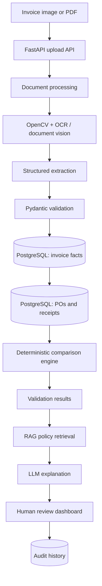

# AI Invoice & Purchase Order Auditor

> **Project status:** Planning / MVP design. This repository currently documents the intended system architecture and development plan; it does not yet contain a production application.

## 1. Project Overview

AI Invoice & Purchase Order Auditor is a document-intelligence workflow for accounts-payable (AP) teams. It receives supplier invoices as images or PDFs, extracts invoice facts, matches them with internal purchase orders (POs) and delivery receipts, applies explicit validation rules, and presents exceptions for human review.

The objective is to reduce repetitive manual verification while retaining traceability and human control for uncertain, high-risk, or policy-sensitive decisions.

### Assumptions for the MVP

- Company PO, goods-receipt, and supplier-reference data can be imported or entered into PostgreSQL.
- Invoices are primarily printed/typed PDFs or images; handwritten or severely degraded documents may need manual review.
- The initial implementation supports a deliberately small set of invoice fields and validation rules.
- Examples in this document are illustrative only; they are not company data or production claims.

## 2. Business Problem

AP teams often compare an invoice manually against a PO, delivery receipt, contract terms, and internal approval rules. The process is time-consuming and error-prone, especially when documents arrive in different layouts or exceptions are hidden in line-item details.

The work is not simply reading a PDF. It is a **three-way matching and exception-management workflow**:

1. Capture invoice information accurately.
2. Match it to approved internal records.
3. Check prices, quantities, totals, tax, duplicate references, and receipt status using known rules.
4. Route discrepancies to a person with evidence and a clear next action.

## 3. Proposed Solution

The system combines document processing, structured data, deterministic validation, retrieval, and language-model assistance:

- Process uploaded invoice PDFs/images with computer vision and OCR.
- Normalize extracted values into a validated invoice schema.
- Query PostgreSQL for PO and delivery-receipt records.
- Run deterministic Python rules for financial and operational matching.
- Retrieve relevant policies or SOPs from a RAG knowledge base.
- Ask an LLM to explain validated findings in plain language, grounded in the structured results and retrieved policy excerpts.
- Let AP reviewers approve, reject, or request follow-up; preserve the decision and evidence in audit history.

## 4. Why This Is More Than a Generic LLM Wrapper

This product automates a specific financial-control workflow, not an open-ended “chat with PDF” experience. The model is not the system of record and must not guess financial outcomes.

| Responsibility | Primary mechanism | Why |
| --- | --- | --- |
| Invoice facts, POs, receipts, decisions | PostgreSQL | Queryable, relational, auditable records |
| Policies, SOPs, approval guidance | RAG / vector database | Semantic retrieval over unstructured documents |
| Amount, quantity, tax, and tolerance checks | Deterministic Python logic | Repeatable, testable, precise outcomes |
| Extraction assistance and human-readable explanations | LLM API | Flexible document understanding and natural language |

The deterministic engine decides whether facts satisfy defined rules. The LLM can make those results easier to understand and can recommend a policy-aware next step, but it does not replace calculations, database lookups, or human approval.

## 5. Key Features

- Invoice PDF and image upload.
- Image preprocessing, OCR, and document-quality assessment.
- Structured capture of supplier, invoice number, dates, currency, totals, tax, and line items.
- Schema and data-quality validation with Pydantic.
- PO and delivery-receipt matching for a focused MVP dataset.
- Deterministic invoice/PO/receipt comparisons and configurable tolerances.
- Duplicate-invoice checks.
- Clear exception status, evidence, and rule-level findings.
- Retrieval of relevant internal policies and SOPs.
- LLM-generated explanations and suggested reviewer actions, grounded in results.
- Streamlit review dashboard and durable audit history.

## 6. High-Level Architecture



The frontend begins as Streamlit. FastAPI is the service boundary for uploads, processing, review actions, and future integrations. PostgreSQL owns structured operational facts; a vector database indexes policy content separately.

## 7. Detailed Component Architecture

| Component | Responsibilities | Inputs | Outputs |
| --- | --- | --- |
| Streamlit dashboard | Upload documents; display exceptions; capture reviewer decisions | User actions, API responses | Upload request, review decision |
| FastAPI | Authentication boundary (future), request validation, orchestration, API endpoints | Files, identifiers, decisions | Processing/job status and data |
| Document processing | PDF rasterization, image cleanup, page handling, quality checks | PDF/image | Prepared page images, metadata |
| OpenCV + OCR/document vision | Deskew, denoise, crop/region detection, text/layout recognition | Prepared images | Text, bounding boxes, confidence |
| Structured extraction | Map OCR/layout output to invoice fields and line items; optionally use LLM extraction | OCR result | Candidate invoice JSON |
| Pydantic validation | Validate types, required fields, dates, currency, arithmetic and confidence flags | Candidate JSON | Validated data or actionable errors |
| PostgreSQL | Store invoices, suppliers, POs, PO lines, delivery receipts, validations, reviews | Validated records | Relational matches and audit data |
| Matching service | Find likely PO/receipt candidates using invoice references, supplier, and identifiers | Validated invoice | Candidate company records |
| Deterministic engine | Apply matching rules, arithmetic, tolerances, and duplicate checks | Invoice + PO + receipt | Rule-level pass/fail/needs-review findings |
| RAG service | Chunk, embed, and retrieve relevant policy/SOP passages | Exception context | Retrieved, cited policy snippets |
| LLM service | Explain only the supplied findings; propose next actions under retrieved policies | Results + policy snippets | Structured explanation and recommendations |
| Audit service | Store processing version, findings, policy references, decisions, timestamps | Events and reviewer actions | Immutable-oriented history |

## 8. End-to-End Data Flow

```text
Invoice / PDF
    ↓
FastAPI Upload
    ↓
Document Processing
    ↓
OCR / Computer Vision
    ↓
Structured Extraction
    ↓
Pydantic Validation
    ↓
PostgreSQL Company Records
    ↓
Deterministic Comparison Engine
    ↓
Validation Results
    ↓
RAG Policy Retrieval
    ↓
LLM Explanation
    ↓
Human Review
    ↓
Audit History
```

1. A user uploads an invoice image or PDF through a FastAPI endpoint (initially from Streamlit).
2. The processing layer detects pages, produces usable images, and records the original-file metadata.
3. OCR/document vision returns text, layout locations, and confidence information.
4. Extraction produces a candidate structured invoice: header fields, totals, taxes, and selected line items.
5. Pydantic validates the candidate and flags missing, malformed, inconsistent, or low-confidence values.
6. The system saves validated invoice facts and searches PostgreSQL for the corresponding PO and delivery receipt.
7. Deterministic rules calculate comparisons and produce evidence-backed findings.
8. For exceptions, RAG retrieves policy/SOP passages relevant to the discrepancy type.
9. The LLM turns the already-determined findings and retrieved guidance into a concise explanation and recommended review action.
10. An AP employee reviews the evidence, records a decision, and the system writes the result to audit history.

## 9. Role of Computer Vision

Computer vision makes OCR more reliable; it is not only an optional image filter. OpenCV can improve scanned documents by correcting orientation, deskewing, denoising, contrast enhancement, cropping borders, and detecting page regions or tables. OCR/document-vision tooling then converts visual content into text and layout signals such as bounding boxes and confidence scores.

For the MVP, prioritize dependable preprocessing and extraction of invoice header fields before pursuing complex, vendor-agnostic table understanding. If a document is unreadable or extraction confidence is low, route it to review instead of manufacturing certainty.

## 10. Role of the LLM

The LLM is useful in bounded places:

- Convert noisy OCR/layout output into a defined invoice schema when rules alone cannot handle layout variation.
- Normalize labels such as “Bill No.” versus “Invoice #,” while preserving source evidence.
- Explain a deterministic finding in plain language.
- Combine retrieved policy passages with a validation result to suggest a reviewer’s next action.

The LLM should receive a constrained prompt and return a Pydantic-compatible structured response. It should never be asked to invent a PO, infer an unobserved receipt, decide exact totals, or silently override deterministic checks. Its output is assistive and should include uncertainty where applicable.

## 11. Role of RAG

RAG (retrieval-augmented generation) provides relevant unstructured internal knowledge at review time. Candidate knowledge sources include AP SOPs, approval matrices, supplier-payment procedures, discrepancy escalation guidance, and tolerance-policy documents.

Policy documents are chunked, embedded, stored in a vector database, and retrieved using the exception context (for example, “quantity invoiced exceeds received quantity”). The LLM is given only the most relevant retrieved passages, ideally with document/version metadata. RAG is **not** the source for PO amounts, receipt quantities, or invoice facts; those remain in PostgreSQL.

## 12. Role of FastAPI

FastAPI is the backend contract that separates the UI from processing and data services. It should expose focused endpoints such as:

- upload an invoice and initiate processing;
- check processing status and fetch a normalized invoice;
- retrieve matching records and validation findings;
- request an explanation for an existing result;
- record a human-review decision and reason.

Pydantic models provide clear request/response contracts. Longer OCR or LLM work should ultimately run as background jobs or through a queue so the upload request remains responsive; the MVP may begin synchronously with small samples and document the limitation.

## 13. Database Design

PostgreSQL stores structured facts and workflow state. The exact schema should evolve from real data, but the conceptual MVP entities are:

| Table/entity | Key fields (illustrative) | Purpose |
| --- | --- | --- |
| `suppliers` | supplier_id, name, normalized_name, tax_id | Supplier reference data |
| `purchase_orders` | po_id, po_number, supplier_id, currency, status, order_date | PO header |
| `purchase_order_lines` | po_line_id, po_id, item_code, description, ordered_qty, unit_price, tax_rate | PO commitments |
| `delivery_receipts` | receipt_id, receipt_number, po_id, receipt_date, status | Receipt header |
| `delivery_receipt_lines` | receipt_line_id, receipt_id, po_line_id, received_qty | Received-goods evidence |
| `invoices` | invoice_id, supplier_id, invoice_number, invoice_date, currency, subtotal, tax, total, source_path, extraction_status | Extracted invoice header and source metadata |
| `invoice_lines` | invoice_line_id, invoice_id, description, quantity, unit_price, line_total, matched_po_line_id | Extracted invoice details |
| `validation_runs` | run_id, invoice_id, ruleset_version, status, created_at | A repeatable rules-engine execution |
| `validation_findings` | finding_id, run_id, rule_code, severity, result, expected_value, observed_value, evidence | Individual rule outcome |
| `review_decisions` | decision_id, invoice_id, reviewer_id, decision, reason, decided_at | Human approval/rejection/escalation |
| `audit_events` | event_id, entity_type, entity_id, event_type, actor, timestamp, payload_reference | Traceable workflow history |

Recommended controls include unique constraints for supplier + invoice number where business rules permit, decimal/money-safe numeric types, foreign keys, timestamps, source-document references, and ruleset/model/policy versions. Store secrets outside the database and repository (for example, environment configuration); never commit `.env` files.

## 14. MVP Scope

The MVP should prove one complete, auditable workflow rather than attempt every invoice format and enterprise integration.

**In scope**

- Upload a single invoice PDF/image.
- Extract a limited header schema: supplier, invoice number/date, PO number, currency, subtotal, tax, total.
- Seed or import a small, clearly labeled sample set of PO and receipt records.
- Match primarily by PO number, supplier, and invoice reference.
- Validate duplicates, total arithmetic, currency, PO total/line price where available, and invoice quantity against received quantity.
- Produce `pass`, `exception`, or `needs_review` outcomes.
- Retrieve policy guidance for at least a small controlled policy set.
- Show results, explanation, evidence, and a review decision in Streamlit.

**Explicitly out of scope for the MVP**

- Autonomous payment approval or ERP write-back.
- Broad support for every vendor layout, language, handwriting, or low-quality scan.
- Full contract interpretation, fraud detection, or legal/tax compliance advice.
- Production-scale authentication, multi-tenant isolation, queue infrastructure, and comprehensive security certification.

## 15. Development Roadmap

| Phase | Goal | Main tasks | Expected deliverable | Concepts to learn |
| --- | --- | --- | --- | --- |
| 1. OCR + structured invoice extraction | Turn a small set of documents into reliable invoice JSON | Collect non-sensitive sample documents; preprocess images; run OCR; define Pydantic models; measure field confidence and extraction errors | A repeatable notebook/script-level extraction experiment and documented schema | OCR, OpenCV preprocessing, document layouts, Pydantic, confidence handling |
| 2. PostgreSQL + purchase-order matching | Establish structured company-record matching | Model tables; load illustrative PO/receipt data; implement supplier/PO lookup and match states | Database schema/migrations and match-result design | Relational modeling, SQL, foreign keys, indexes, normalization |
| 3. Deterministic validation engine | Make exact validation trustworthy and testable | Define rules and tolerances; compare totals, quantities, prices, currency, and duplicates; produce rule-level evidence | Versioned rules specification and testable validation results | Decimal arithmetic, business rules, unit tests, explainable decisions |
| 4. FastAPI backend | Provide a stable application interface | Create Pydantic API contracts; add upload, result, and review endpoints; connect services; document errors and statuses | Local API serving one end-to-end flow | REST APIs, request validation, service boundaries, asynchronous-work patterns |
| 5. RAG for company policies | Retrieve relevant internal guidance for exceptions | Prepare approved policy samples; chunk and embed; select a vector store; evaluate retrieval relevance and citation metadata | Policy retrieval service with cited passages | Embeddings, chunking, similarity search, retrieval evaluation |
| 6. LLM explanations | Produce grounded reviewer-friendly explanations | Design constrained prompts; pass only validated findings and retrieved policy; require structured output; test hallucination resistance | Explanation response with policy references and uncertainty notes | Prompt design, structured outputs, grounding, LLM evaluation |
| 7. Streamlit dashboard | Make exceptions reviewable by employees | Build upload/result/review screens; show source evidence, findings, policy context, and reviewer actions | Usable local review dashboard | Streamlit, state management, UX for human-in-the-loop systems |
| 8. Evaluation + Docker + deployment | Make the MVP reproducible and measurable | Build a labeled evaluation set; run metrics; add logs/configuration; containerize services; document deployment assumptions | Dockerized MVP, evaluation report, and deployment guide | Containers, configuration, observability, testing, deployment basics |

## 16. Evaluation Metrics

Evaluate each stage separately so a low-quality OCR result is not mistaken for a rules-engine failure.

| Area | Example metrics | What good looks like for an MVP |
| --- | --- | --- |
| OCR/document processing | Readability pass rate, OCR confidence, page-processing failure rate | Documents that fail quality checks are clearly routed to review |
| Structured extraction | Field-level precision/recall/F1; exact match for invoice number, PO number, totals; schema-validation failure rate | Priority financial fields are measured against a labeled sample set |
| Matching | Correct PO/receipt match rate; unmatched false-positive rate | Conservative matching: ambiguous results are `needs_review` |
| Deterministic validation | Rule precision/recall; false pass rate; false exception rate; test coverage | Every result cites the rule and input values used |
| RAG | Retrieval recall@k; policy citation relevance; stale-document rate | Relevant policy text is retrieved with version metadata |
| LLM explanations | Factual consistency with findings; unsupported-claim rate; reviewer usefulness rating | Explanations summarize evidence rather than add facts |
| Workflow | Review turnaround time; automation rate; override rate; audit completeness | Efficiency improves without hiding risky cases |

Metrics require a small labeled evaluation dataset and reviewer feedback. Never report accuracy without defining its dataset, fields, threshold, and period.

## 17. Future Improvements

- ERP, procurement, and warehouse-system connectors with read-only first integration.
- Vendor-specific extraction templates plus a generalized fallback.
- Better line-item/table extraction and fuzzy item matching with review thresholds.
- Configurable tolerance rules and approval routing by business unit.
- Background job queue, retries, dead-letter handling, and processing observability.
- Role-based access, single sign-on, encryption, retention controls, and redaction.
- Active-learning loop based on reviewer corrections.
- Multi-language support and improved handling for scans/handwriting.
- Anomaly detection as a separate, carefully evaluated signal—not a replacement for validation rules.
- Production monitoring for model, ruleset, policy, and retrieval-version changes.

## 18. Project Limitations

- OCR quality depends on scan quality, language, layout, and document complexity.
- A PO number alone may not uniquely identify the correct record; matching needs conservative thresholds.
- Receipt records may be delayed or incomplete, making a valid invoice appear exceptional temporarily.
- RAG can retrieve irrelevant or outdated policy text unless content governance and versioning are maintained.
- LLM output can be incomplete or misleading; it must be constrained and reviewed, especially for finance operations.
- The design does not provide tax, legal, accounting, or compliance advice.
- This planned MVP is not production-ready until it is tested with authorized data, security controls, operational monitoring, and stakeholder validation.

## 19. Interview Explanation

**Short version:**

> I designed an AI invoice and purchase-order auditor to automate AP three-way matching. Computer vision and OCR read invoices, Pydantic turns the extraction into a validated schema, and PostgreSQL stores invoices, POs, and delivery receipts. A deterministic Python rules engine performs exact financial comparisons. RAG retrieves internal policies only when an exception needs context, and an LLM explains the already-validated result in plain language. Employees retain final review, and every processing and decision step is captured in audit history.

**Key design decision:**

> I separated structured facts, unstructured policy knowledge, deterministic controls, and generative language tasks. That keeps comparisons reproducible and auditable while still using LLMs where their flexibility is valuable.

**Illustrative exception:**

> If an invoice bills 120 units while the linked receipt shows 100, the deterministic engine reports the 20-unit variance. RAG retrieves the applicable quantity-variance SOP, and the LLM explains the mismatch and suggests the policy-aligned next step. The reviewer—not the model—decides whether to hold, approve, or escalate the invoice.

## 20. Suggested Initial Technology Stack

| Need | Initial choice |
| --- | --- |
| Core language | Python |
| API layer | FastAPI + Pydantic |
| Image preprocessing | OpenCV |
| OCR/document vision | Provider/tool selected after a small document evaluation |
| Structured database | PostgreSQL |
| Policy retrieval | RAG with a vector database selected after evaluation |
| Language-model capability | LLM API with structured outputs |
| Initial UI | Streamlit |
| Packaging/deployment | Docker |
| Source control | GitHub |

## Next Recommended Implementation Step

Begin **Phase 1** by agreeing on a minimal invoice schema and assembling a small, authorized, non-sensitive sample of invoices representing the layouts you expect first. Define how each field will be labeled for evaluation before selecting an OCR/document-vision tool. That gives later database, rules, and LLM work a reliable foundation.
